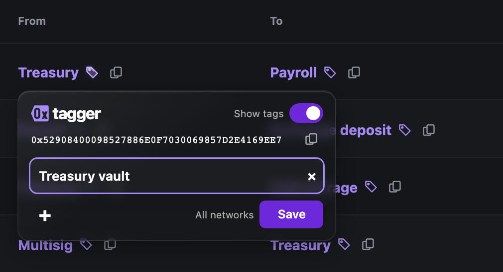

<h1 align="center">0xtagger</h1>
<p align="center"><strong>Your tags belong to you.</strong><br>A private address book for wallet tags, stored in your browser or on a server you control.</p>
<p align="center"><a href="#get-started">Get started</a> · <a href="INSTALL.md">Setup guide</a> · <a href="LICENSE">MIT</a></p>


Tag wallet addresses directly on Etherscan, Safe, and other enabled sites. Carry the same context between them. No account. No analytics.

- **Private by default.** Your book stays in your browser.
- **Your storage.** Share between devices through a server you run.
- **Take it with you.** Import and export your tags.

### Privacy

Your stored book stays under your control. **Websites can read tags displayed on their pages.**

0xtagger reads a website's own stored address book only when you ask it to, from **Import names from
Safe**, and shows you what it found before anything is saved. Nothing is read while you browse.

### Get started

```sh
git clone https://github.com/wavey0x/0xtagger.git
```

1. Open `brave://extensions` or `chrome://extensions`, enable **Developer mode**, and **Load unpacked** → this project's `extension` folder.
2. Enable the website in the popup. Click the purple tag glyph beside an address to tag it.

#### Sharing a book between devices

Run a server, with Python 3.10+ and [uv](https://docs.astral.sh/uv/getting-started/installation/):

```sh
uv run 0xtagger serve
```

Open the address book menu → **Connect to a server**, then paste the link the server prints.

For a private browser view of that same book, [serve it through Tailscale](INSTALL.md#browse-privately-through-tailscale).
Your Tailscale identity opens it directly, with no key in the bookmark.



<sub>Editor screenshot uses sample data.</sub>

Early development; installed as an unpacked extension. See the [setup guide](INSTALL.md) for remote hosting, backups, updates, and development checks.
